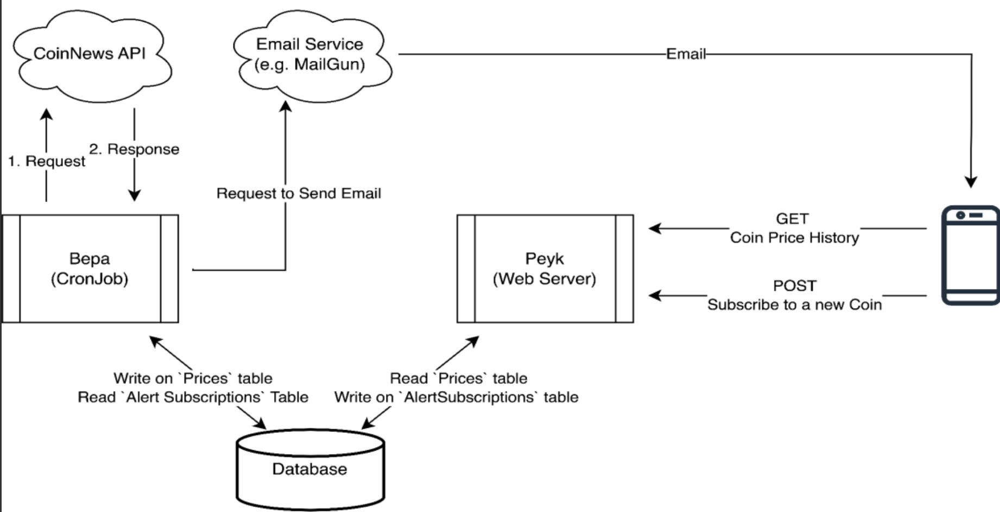

# AUT Cloud Computing Final Project

Cryptocurrency price monitoring and alert system built as a multi-service application for the Amirkabir University of Technology (AUT) Cloud Computing course.

Users can look up stored coin price history and subscribe to email alerts when a coin’s price change exceeds a chosen percentage threshold. A background worker periodically polls a CoinNews data service, stores prices in MySQL, evaluates subscriptions, and sends alerts through Mailgun.

## Problem and motivation

The project demonstrates a practical microservices-style design for a cloud computing course: separate user-facing API and UI, a polling worker, a shared relational database, containerized local development, and Kubernetes deployment with Helm.

## Key features

| Feature | Status | Where it lives |
| --- | --- | --- |
| Poll CoinNews for coin names and prices on an interval | Implemented | `service_bepa` |
| Persist prices and known coins in MySQL | Implemented | `service_bepa`, `service_mysql_db` |
| Email alerts when price change ≥ subscription threshold | Implemented (Mailgun API) | `service_bepa` |
| REST API to create alert subscriptions | Implemented | `service_peyk` |
| REST API to fetch stored price history | Implemented | `service_peyk` |
| Web UI for price history and subscriptions | Implemented | `service_react` |
| Local multi-container run with Docker Compose | Implemented | `docker-compose.yml`, `run.sh` |
| Kubernetes deploy via Helm charts | Implemented | `deployments/` |
| Automated test suite for business logic | Not implemented | Placeholder / default scaffold tests only |

## Architecture



High-level flow:

1. **React UI** (`:3000`) calls the Peyk API (`:8001`).
2. **Peyk** reads/writes MySQL (`coin_db`): subscriptions and price history.
3. **Bepa** polls **CoinNews** (`:8000`), writes new prices, checks subscriptions, and requests Mailgun to send email.
4. **MySQL** holds `Coin`, `Prices`, and `AlertSubscriptions`.

Notes relative to the diagram:

- Bepa is a long-running Python loop (`sleep` + poll), not a Kubernetes `CronJob`. Locally and in Helm it runs as a container/Deployment.
- Price history is exposed as `POST /price/` (not GET), matching the Peyk views.
- CoinNews is consumed as a prebuilt image; its application source is not in this repository.
- The React frontend is part of this repo and Compose/Helm stack; it is not shown on the architecture image.

```text
┌─────────────┐     POST /price/          ┌─────────────┐
│ React UI    │──────────────────────────▶│ Peyk        │
│ :3000       │     POST /subscribe/      │ Django+DRF  │
└─────────────┘                           │ :8001       │
                                          └──────┬──────┘
                                                 │
┌─────────────┐     GET /api/data/...     ┌──────▼──────┐     Mailgun
│ CoinNews    │◀──────────────────────────│ Bepa worker │────────────▶ email
│ :8000       │                           │ (poll loop) │
└─────────────┘                           └──────┬──────┘
                                                 │
                                          ┌──────▼──────┐
                                          │ MySQL 8.0   │
                                          │ coin_db     │
                                          └─────────────┘
```

## Technology stack

| Layer | Technologies |
| --- | --- |
| Frontend | React 18, Create React App (`react-scripts`), Axios |
| User API | Django 4.2, Django REST Framework 3.14, `mysqlclient` / PyMySQL |
| Worker | Python 3.9, `requests`, PyMySQL |
| Database | MySQL 8.0 |
| External services | CoinNews Docker image (`amirhossein21/coinnews.macos:v0.2`), Mailgun HTTP API |
| Local orchestration | Docker Compose 3.8 |
| Kubernetes | Helm charts under `deployments/` (Deployments, Services, ConfigMaps, Secrets; optional HPA/Ingress) |

## Repository structure

```text
AUT-CC-Final-Project/
├── Architecture.png              # System diagram
├── docker-compose.yml            # Local multi-service stack
├── run.sh / stop.sh              # Start/stop Compose services
├── env/shared.env                # Shared MySQL-related env vars
├── LICENSE                       # MIT
├── service_bepa/                 # Price poller + alert worker
├── service_peyk/                 # Django REST API
├── service_react/                # React UI (+ Dockerfile)
├── service_coin_news/            # CoinNews config.yml only (image is external)
├── service_mysql_db/             # Init SQL (+ Compose data volume path)
└── deployments/                  # Helm charts and install/delete scripts
    ├── install.sh / delete.sh
    ├── mysql_db/
    ├── service_bepa/
    ├── service_peyk/
    ├── service_react/
    └── service_coin_news/
```

Course PDFs (`CC_FinalProject.pdf`, `9831032_9831011_FinalProject.pdf`) are included for assignment context; they are not required to run the software.

## Main components

### Bepa (`service_bepa`)

Background worker that:

1. `GET {COINNEWS_ENDPOINT}/api/data/` for coin names
2. Inserts unknown names into `Coin`
3. `GET {COINNEWS_ENDPOINT}/api/data/{coin_name}/` for each coin’s current `value`
4. Compares against the latest row in `Prices`, computes relative change  
   `|current - last| / |last|` (with a small guard when `last == 0`)
5. Selects subscriptions where `difference_percentage <= change * 100` and emails via Mailgun
6. Inserts the new price into `Prices`
7. Sleeps `INTERVAL_SECONDS` and repeats

See [service_bepa/README.md](service_bepa/README.md).

### Peyk (`service_peyk`)

Django + DRF API on `APP_IP`:`APP_PORT` (Compose default `0.0.0.0:8001`):

| Method | Path | Body | Behavior |
| --- | --- | --- | --- |
| `POST` | `/subscribe/` | `email`, `coin_name`, `difference_percentage` (0–100) | Creates `AlertSubscriptions` row if coin exists |
| `POST` | `/price/` | `coin_name` | Returns stored price history for that coin |

See [service_peyk/README.md](service_peyk/README.md).

### React UI (`service_react`)

CRA app with two forms: price history query and alert subscription. API base URL is hardcoded in `app_react/src/config.js` as `http://localhost:8001/`.

See [service_react/app_react/README.md](service_react/app_react/README.md).

### CoinNews (`service_coin_news`)

No application source here. Compose/Helm run image `amirhossein21/coinnews.macos:v0.2` with `config.yml` (units, worker interval, HTTP port). Bepa treats it as the price source.

### MySQL (`service_mysql_db` + Helm `deployments/mysql_db`)

Schema (Compose init script and Helm `initializationFiles`):

- `Coin(coin_name PK)`
- `Prices(coin_name, time_stamp, price)` FK → `Coin`
- `AlertSubscriptions(email, coin_name, difference_percentage)` FK → `Coin`, unique `(email, coin_name)`

See [deployments/mysql_db/README.md](deployments/mysql_db/README.md) for the Kubernetes chart used in this project.

## Installation and local run (Docker Compose)

### Prerequisites

- Docker and Docker Compose
- Ability to pull `mysql:8.0` and `amirhossein21/coinnews.macos:v0.2`
- Local images `bepa:v1`, `peyk:v1`, and `react:v1` are built from the Dockerfiles on first `docker-compose up`

### Configuration

Shared variables in `env/shared.env`:

| Variable | Purpose |
| --- | --- |
| `MYSQL_DATABASE` | Database name (`coin_db`) |
| `MYSQL_ROOT_PASSWORD` | MySQL root password |
| `MYSQL_HOST` | Hostname of MySQL service |
| `MYSQL_PORT` | MySQL port |
| `MYSQL_USER` | Declared in env file; Bepa/Peyk currently connect as `root` |

Bepa-specific (set in `docker-compose.yml`):

| Variable | Example | Purpose |
| --- | --- | --- |
| `INTERVAL_SECONDS` | `180` | Poll interval |
| `COINNEWS_ENDPOINT` | `http://coin_news:8000` | CoinNews base URL |

Peyk-specific:

| Variable | Example | Purpose |
| --- | --- | --- |
| `APP_IP` | `0.0.0.0` | Bind address |
| `APP_PORT` | `8001` | HTTP port |

Mailgun credentials are currently hardcoded in `service_bepa/bepa.py` (not environment variables). Treat them as sensitive; rotate if this repository is public.

### Start / stop

From the project root:

```bash
chmod +x run.sh stop.sh   # once, if needed
./run.sh                  # starts mysql_db, coin_news, bepa, peyk, react
```

Or:

```bash
docker-compose up -d --build
```

Stop:

```bash
./stop.sh
# equivalent: docker-compose down
```

### Endpoints after Compose start

| Service | URL / port |
| --- | --- |
| React UI | http://localhost:3000 |
| Peyk API | http://localhost:8001 |
| CoinNews | http://localhost:8000 |
| Bepa | Port `8002` is published in Compose but Bepa does not serve HTTP |
| MySQL | localhost:3306 |

First MySQL start applies `service_mysql_db/script/create_tables.sql` via `/docker-entrypoint-initdb.d`. Data persists under `service_mysql_db/data/` (gitignored).

## Usage examples

Subscribe to an alert:

```bash
curl -X POST http://localhost:8001/subscribe/ \
  -H 'Content-Type: application/json' \
  -d '{"email":"you@example.com","coin_name":"bitcoin","difference_percentage":5}'
```

Fetch stored price history:

```bash
curl -X POST http://localhost:8001/price/ \
  -H 'Content-Type: application/json' \
  -d '{"coin_name":"bitcoin"}'
```

Coin names must already exist in `Coin` (normally inserted by Bepa after it discovers them from CoinNews). Compose’s sample CoinNews config includes units such as `bitcoin` and `docoin`; the Helm CoinNews values list a larger set (for example `dogecoin`, `usdcoin`).

## Kubernetes deployment (Helm)

Charts and helpers live under [`deployments/`](deployments/README.md).

```bash
cd deployments
chmod +x install.sh delete.sh
./install.sh    # helm install mysql-db, coin-news, bepa, peyk, react
./delete.sh     # helm delete those releases
```

Images for Bepa, Peyk, and React must be available to the cluster (built/loaded locally or pushed to a registry and referenced in each chart’s `values.yaml`). CoinNews uses the public image tag above. Chart values set service types (for example Peyk/React `LoadBalancer`), ConfigMaps/Secrets, and MySQL init SQL.

## Testing

- `service_peyk/.../tests.py` is an empty Django test placeholder.
- `service_react/app_react/src/App.test.js` is the default CRA “learn react” test and does not match the current UI.

There is no project-level automated test command covering the end-to-end alert flow.

## Design decisions and skills demonstrated

- Split **read/write user API** (Peyk) from **ingestion/alerting** (Bepa) with a shared MySQL schema
- Containerize each service with multi-stage Python Dockerfiles and a Node-based React image
- Provide both **Compose** (dev/demo) and **Helm** (Kubernetes) deployment paths
- Integrate an external price simulator (CoinNews) and an external email API (Mailgun)
- Expose a minimal React client for the two primary user actions

## Limitations and assumptions

- Academic / demonstration project: Django `DEBUG=True`, permissive `ALLOWED_HOSTS`, and secrets in source or plain env files
- Mailgun API key and sandbox domain are hardcoded in Bepa
- Bepa’s subscription query does not filter by `coin_name` in SQL (parameter is unused in the query string); alert matching behavior should be verified against your expectations
- Relative-change formula has an inline `TODO` in Bepa
- React API URL is fixed to `http://localhost:8001/`; Kubernetes LoadBalancer/Ingress URLs require a code or config change
- Browser calls from the React origin to Peyk may require CORS configuration (not present in Django settings as checked in)
- CoinNews source code is external; behavior depends on that image and `config.yml`
- Helm charts for Bepa/Peyk/React mount `hostPath` volumes as configured in `values.yaml` (environment-specific)
- Meaningful automated tests for the business logic are not present

## License

[MIT](LICENSE) — Copyright (c) 2023 Mohammad Javad Zandiyeh
